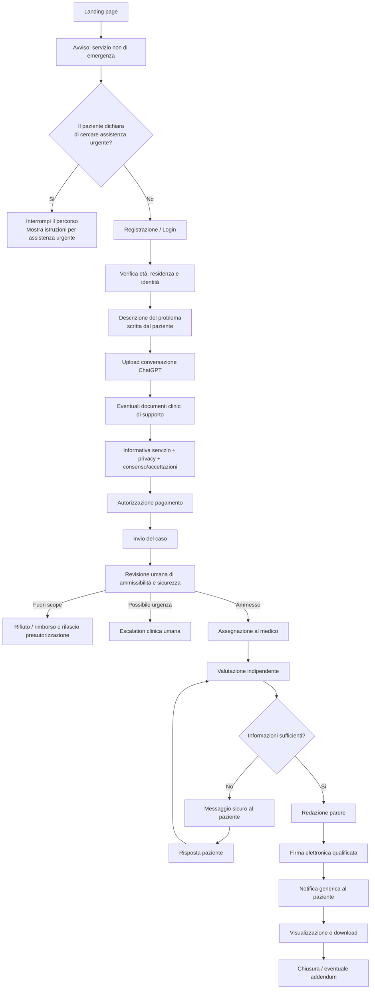
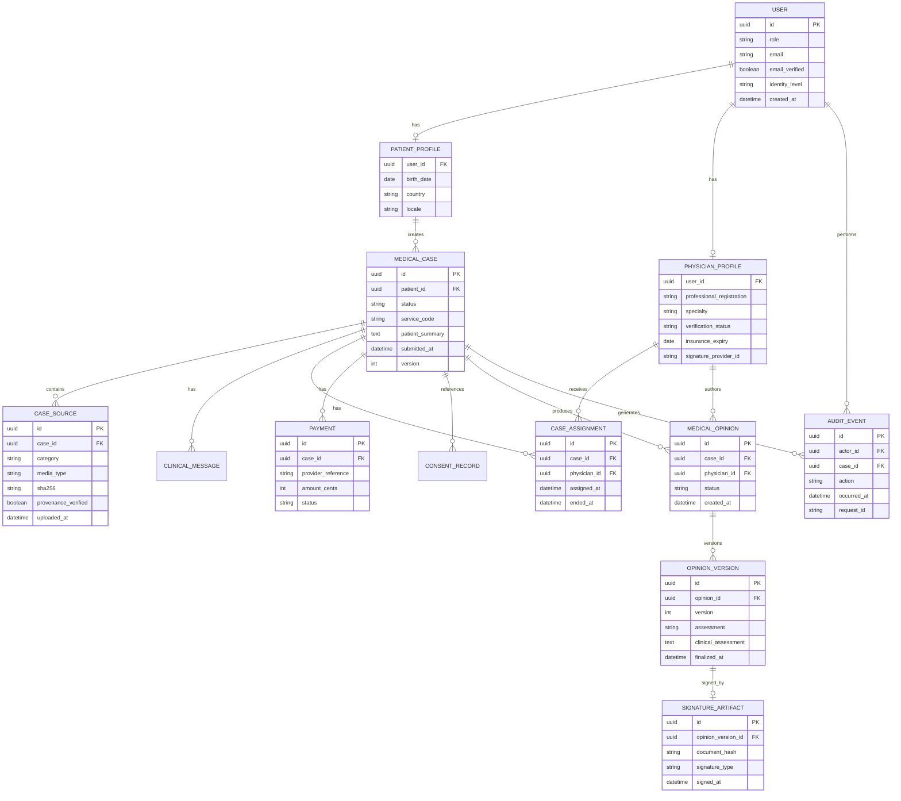
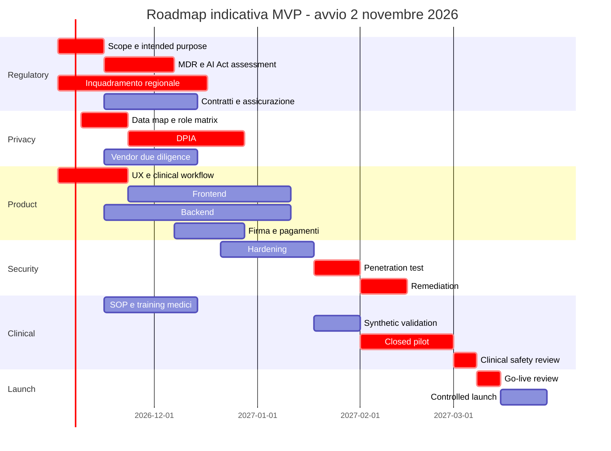

# Blueprint tecnico e normativo per una piattaforma italiana di verifica medica delle ipotesi diagnostiche emerse da ChatGPT

**Stato normativo e tecnologico: 27 ottobre 2026.**  
**Assunzioni di progetto:** utenti maggiorenni residenti in Italia; servizio esclusivamente non urgente; il paziente porta una conversazione già avuta con ChatGPT oppure, in una fase futura, la piattaforma potrebbe integrare le API OpenAI; il medico effettua una revisione clinica indipendente asincrona e rilascia un parere firmato.

## Executive summary

Il modello è realizzabile, ma la scelta architetturale determina in larga misura il profilo regolatorio.

La configurazione che raccomando per l'MVP è deliberatamente semplice:

> **il paziente utilizza ChatGPT per conto proprio; la piattaforma non interroga alcun LLM, non interpreta la conversazione, non genera diagnosi, non effettua triage automatico e non assegna priorità cliniche. Riceve il documento, lo mostra a un medico e consente al medico di acquisire ulteriori informazioni, formulare autonomamente il proprio giudizio e firmarlo.**

Questa separazione è importante perché il MDR qualifica il software in funzione della sua **destinazione d'uso**; la guida MDCG 2019-11 rev.1 del giugno 2025 chiarisce inoltre che la destinazione d'uso deriva anche dalle dichiarazioni promozionali e commerciali del produttore. Un software che si limita a trasferire, conservare e visualizzare informazioni sanitarie non diventa automaticamente un Medical Device Software, mentre un software che elabora o interpreta informazioni cliniche per uno scopo medico può diventarlo. La stessa guida fa specificamente l'esempio dei sistemi di telemedicina: la mera comunicazione/visualizzazione non costituisce necessariamente un dispositivo medico; i moduli che interpretano i dati o producono informazioni mediche possono invece esserlo. citeturn21view0turn21view1turn3view2

Di conseguenza, **la piattaforma dovrebbe essere progettata come infrastruttura di comunicazione e documentazione di una prestazione professionale umana**, non come software che “verifica la diagnosi”. La prestazione sanitaria è svolta dal medico; il software consente di erogarla.

La formula commerciale che userei è quindi leggermente diversa da “convalida la diagnosi di ChatGPT”:

> **Hai consultato ChatGPT per i tuoi sintomi? Fai valutare da un medico le ipotesi emerse.**  
> Carica la conversazione e ricevi una valutazione clinica indipendente. Il medico potrà concordare, correggere le ipotesi, chiedere ulteriori informazioni oppure indicare che sono necessari visita o accertamenti.

Questa formulazione è anche clinicamente preferibile: evita di trasformare il medico in un “certificatore” dell'output AI e riduce automation bias e aspettative improprie. È coerente con l'art. 7 della legge italiana 132/2025, secondo cui l'AI può supportare prevenzione, diagnosi, cura e scelta terapeutica, ma la decisione rimane in capo agli esercenti la professione medica; la stessa norma riconosce il diritto dell'interessato a essere informato sull'impiego dell'AI e richiede affidabilità, verifica periodica e aggiornamento dei sistemi AI sanitari. citeturn20view0

Il punto più delicato non è in realtà ChatGPT, ma **la natura della prestazione medica asincrona**. Le indicazioni nazionali sulla telemedicina riconoscono televisita, teleconsulto, teleconsulenza e telerefertazione come forme di prestazione sanitaria, ma il modello “paziente → caricamento documentale → medico → parere asincrono” non coincide perfettamente con il teleconsulto medico, che nella tassonomia nazionale è centrato sulla relazione fra professionisti, né deve essere automaticamente equiparato a una normale visita a distanza. Inoltre il Codice di deontologia medica richiede che l'impiego delle ICT rispetti le normali responsabilità della relazione medico-paziente e non consente di usare una relazione esclusivamente virtuale come sostituto indiscriminato della visita medica. citeturn17search3turn7search2turn10search3

Per questo il prodotto deve permettere al medico di concludere:

**concordo**, **concordo parzialmente**, **non concordo**, **informazioni insufficienti**, **necessaria visita/esame obiettivo**, **necessari accertamenti**, **necessaria valutazione urgente**.

Non deve mai obbligarlo a “confermare” qualcosa.

Sul piano privacy, la piattaforma tratta sistematicamente dati sanitari e pazienti: il GDPR è quindi centrale. Il Garante italiano, nel proprio compendio specificamente dedicato alle piattaforme che mettono in contatto pazienti e professionisti sanitari, considera la DPIA particolarmente rilevante e, per le piattaforme del tipo descritto, richiama espressamente i fattori che ne rendono necessario lo svolgimento: dati sanitari, interessati vulnerabili, nuove tecnologie e possibile trattamento su larga scala. Il Garante insiste inoltre sulla corretta attribuzione dei ruoli di titolare/responsabile e sull'adozione di misure di sicurezza adeguate. citeturn6view0turn6view1turn5view0

La scelta consigliata per il primo rilascio è quindi:

| Decisione | MVP raccomandato | Motivo |
|---|---|---|
| ChatGPT | Utilizzato autonomamente dal paziente, fuori dalla piattaforma | Separa nettamente AI e servizio sanitario |
| Importazione | Upload manuale PDF/TXT/immagini o copia-incolla | Nessun accesso alle credenziali OpenAI |
| Interpretazione della chat | Nessuna | Riduce fortemente rischio MDSW |
| Riassunto AI | No | Potrebbe produrre informazione clinicamente rilevante |
| Red-flag NLP | No | È una funzione di triage clinico |
| Prioritizzazione automatica | No | Potrebbe configurare decision support |
| Safety gate | Informazione statica + auto-identificazione paziente + revisione umana | Non interpreta automaticamente i sintomi |
| Decisione clinica | Solo medico | Coerente con legge 132/2025 |
| Referto/parere | Redatto dal medico e firmato digitalmente | Tracciabilità e responsabilità |
| Assistenza in emergenza | Esplicitamente esclusa | Un servizio asincrono non deve essere utilizzato come pronto soccorso |
| API OpenAI | Post-MVP, dopo nuova valutazione MDR/AI Act/DPIA | Aumenta sostanzialmente il perimetro regolatorio |

La **priorità assoluta prima di scrivere funzionalità cliniche** dovrebbe essere la produzione di tre documenti: un *MDR qualification memo* con destinazione d'uso e feature-by-feature assessment; un parere sull'inquadramento regionale della prestazione sanitaria; una DPIA iniziale con matrice dei ruoli privacy. Il fatto che l'LLM generalista possa dimostrare performance diagnostiche superiori ai medici in alcuni benchmark non cambia questo quadro: studi recenti hanno effettivamente mostrato prestazioni standalone degli LLM superiori a gruppi di medici in vignette diagnostiche, ma gli stessi lavori sottolineano la distanza fra benchmark, acquisizione dell'anamnesi e pratica clinica reale. citeturn26search0turn26search29turn26search2

**Destinazione d'uso software che proporrei di cristallizzare nei documenti di prodotto:**

> *La piattaforma consente a pazienti adulti di trasmettere in modo sicuro documenti e informazioni a un professionista medico, consente al professionista di visualizzare tali informazioni, comunicare con il paziente, documentare autonomamente la propria valutazione professionale e rilasciare un parere firmato. Il software non analizza, interpreta o classifica informazioni cliniche, non genera diagnosi o raccomandazioni terapeutiche, non valuta l'urgenza clinica e non sostituisce la decisione del medico.*

Questa frase dovrebbe diventare un vero e proprio **“MDR firewall”**: requisiti software, marketing, UX e roadmap devono rimanere coerenti con essa. La guida MDCG è esplicita nel collegare la qualificazione del software alla destinazione d'uso dichiarata e alle funzionalità che perseguono uno scopo medico. citeturn21view0turn21view1

## Quadro normativo, MDR e classificazione del servizio

**MDR e Medical Device Software.** Il Regolamento (UE) 2017/745 include espressamente il software nella definizione di dispositivo medico quando il produttore lo destina, tra l'altro, alla diagnosi, prevenzione, monitoraggio, previsione, prognosi o trattamento di una malattia. La MDCG 2019-11 rev.1 sottolinea che non tutto il software utilizzato in sanità è MDSW: la semplice ricerca, conservazione, comunicazione o visualizzazione di informazioni non è sufficiente; diventa decisivo se il software elabora o interpreta dati per perseguire un fine medico. citeturn21view0turn21view1

Se invece introducessimo una funzione che prende la conversazione del paziente e produce una diagnosi, un ranking delle diagnosi, una raccomandazione clinica o una classificazione dell'urgenza, saremmo molto più vicini alla Regola 11 del MDR. Essa colloca normalmente in classe IIa il software che fornisce informazioni utilizzate per decisioni diagnostiche o terapeutiche, con passaggio a IIb o III quando le conseguenze delle decisioni possono essere rispettivamente gravi o fatali/irreversibili. citeturn21view2turn3view1

La seguente matrice dovrebbe essere utilizzata dal Product Manager e dal Regulatory Owner durante ogni refinement di prodotto:

| Funzione | MVP | Valutazione MDR preliminare | Decisione |
|---|---:|---|---|
| Upload della conversazione | Sì | Trasmissione/documentazione | Ammessa |
| Visualizzazione PDF/TXT | Sì | Trasmissione/display | Ammessa |
| Messaggistica paziente-medico | Sì | Comunicazione | Ammessa |
| Pagamento/prenotazione | Sì | Amministrativa | Ammessa |
| Firma del parere | Sì | Documentazione della decisione umana | Ammessa |
| Form strutturato compilato dal paziente | Sì | Raccolta dati senza interpretazione | Ammessa |
| Tag dell'urgenza scelto manualmente dal medico | Sì | Decisione umana | Ammessa |
| Ordinamento della coda per orario di arrivo | Sì | Amministrativo | Ammessa |
| Estrazione automatica di sintomi con NLP | No | Potenziale elaborazione medica | Regulatory review |
| Riassunto AI della chat per il medico | No | Può influenzare decisione clinica | Regulatory review |
| Ranking automatico delle diagnosi | No | Diagnostico | Probabile MDSW |
| Calcolo di probabilità diagnostica | No | Diagnostico | Probabile MDSW |
| Rilevamento automatico di red flags | No | Triage/decision support | Probabile MDSW |
| Priorità automatica “urgente/non urgente” | No | Triage | Probabile MDSW |
| Suggerimenti di esami | No | Decision support | Probabile MDSW |
| Bozza AI del parere medico | No | Può influenzare decisione | Da riesaminare prima dell'introduzione |

Le ultime righe sono **valutazioni prudenziali**, non classificazioni giuridiche definitive; la qualificazione dipende da destinazione d'uso, claims e conseguenze cliniche. Tuttavia, la logica della MDCG è sufficientemente chiara da rendere controproducente aggiungere queste funzioni nel primo rilascio. citeturn21view1turn21view2

Particolarmente importante: **il fatto che ChatGPT sia un modello generalista non protegge un tuo prodotto dal MDR**. Se tu prendi un modello generalista e lo incorpori in un prodotto con finalità diagnostica, la qualificazione riguarda il prodotto risultante e la sua destinazione d'uso. La MDCG afferma inoltre che la qualificazione non dipende da dove il software risiede — cloud, app o altra piattaforma — ma dalla sua finalità. citeturn21view0

**AI Act.** L'AI Act considera ad alto rischio, tra le altre categorie, i sistemi AI che costituiscono un prodotto o componente di sicurezza soggetto alla normativa UE di prodotto quando è richiesta una valutazione di conformità di terza parte; la Commissione utilizza proprio i dispositivi medici fra gli esempi. Dopo le modifiche introdotte nel 2026 dal Digital Omnibus sull'AI, il calendario di applicazione è stato modificato: secondo l'attuale FAQ della Commissione, per i sistemi ad alto rischio incorporati in prodotti regolamentati ai sensi dell'art. 6(1), inclusi i dispositivi medici, la scadenza di riferimento è ora il **2 agosto 2028**, mentre per altre categorie high-risk è indicato il 2 dicembre 2027. citeturn14search0turn14search1

Questo produce due scenari radicalmente differenti:

| Architettura | MDR | AI Act |
|---|---|---|
| Nessuna AI nella piattaforma; solo documento portato dal paziente | Solido argomento per non-MDSW, da formalizzare | La piattaforma non sta essa stessa mettendo in servizio un sistema AI clinico |
| API usata solo per task strettamente non clinici | Analisi caso per caso | Obblighi AI applicabili in funzione del ruolo e della funzione |
| API che riassume anamnesi per il medico | Rischio MDSW significativo | Se MDSW soggetto a notified body, possibile high-risk AI |
| API che genera diagnosi/triage | Probabile MDSW | Forte probabilità di high-risk AI se ricorrono le condizioni dell'art. 6(1) |
| AI che emette direttamente conclusione al paziente | Massimo rischio regolatorio | High-risk/product compliance + forte esposizione clinica |

Per l'MVP, **non dovrebbe esserci un “AI system” interno al percorso clinico**. La conversazione AI è un documento fornito dal paziente, come potrebbe esserlo un referto o un elenco di ipotesi scritto altrove.

La legge italiana 132/2025 rafforza la centralità della supervisione medica: l'art. 7 riconosce l'uso dell'AI per prevenzione, diagnosi e cura, attribuisce all'interessato il diritto a essere informato e stabilisce che la decisione resta sempre rimessa agli esercenti la professione medica; dispone anche che i sistemi AI sanitari e i dati utilizzati siano affidabili, periodicamente verificati e aggiornati. citeturn20view0

Se in futuro la piattaforma integrasse un LLM, l'informativa al paziente sul suo impiego dovrebbe quindi essere distinta sia dalla privacy policy sia dal consenso alla prestazione: **“stiamo usando AI” non dovrebbe essere nascosto nelle condizioni generali**.

**Telemedicina e natura della prestazione.** L'Accordo Stato-Regioni 215/CSR del 17 dicembre 2020 costituisce il riferimento unitario nazionale per televisita, teleconsulto medico, teleconsulenza, teleassistenza e telerefertazione, con attuazione demandata alle Regioni. Il Ministero ha successivamente emanato le linee guida sui requisiti funzionali e livelli di servizio dei sistemi di telemedicina. citeturn17search3turn7search2

Non denominerei quindi automaticamente il servizio “teleconsulto”: nel linguaggio istituzionale il teleconsulto ha una qualificazione propria. Nel contratto e nella UX utilizzerei **“parere medico di revisione clinica a distanza”** o **“valutazione medica documentale a distanza”**, finché il legale sanitario non abbia definito esattamente la classificazione applicabile.

La piattaforma deve inoltre poter convertire il caso in una diversa modalità quando il medico ritiene indispensabile l'interazione diretta. Il Codice di deontologia FNOMCeO disciplina l'impiego delle tecnologie informatiche e richiede che non venga sostituita indiscriminatamente la relazione medica con una relazione esclusivamente virtuale. citeturn10search0turn10search3

Questo significa che il workflow corretto non è:

`ChatGPT → medico firma → diagnosi certificata`

ma:

`documentazione del paziente → valutazione professionale → richiesta di integrazione/visita se necessaria → conclusione che può anche essere “non determinabile a distanza”`.

**Regolamentazione regionale.** È uno dei possibili critical path del progetto. L'Accordo nazionale demanda esplicitamente alle Regioni l'implementazione dei servizi di telemedicina. Le regole regionali sulle strutture sanitarie e sugli studi professionali non sono uniformi. citeturn17search3

L'Emilia-Romagna, per esempio, dichiara espressamente che fra gli oggetti dell'autorizzazione sanitaria vi sono anche le sedi da cui vengono erogate prestazioni in telemedicina; la Regione disciplina inoltre separatamente autorizzazione e comunicazione per gli studi professionali. citeturn24search0turn24search17 Nel Lazio, il quadro autorizzatorio delle strutture sanitarie deriva dalla normativa regionale e la Regione ha ulteriormente aggiornato nel 2026 le procedure relative alle comunicazioni delle attività professionali mediche. citeturn24search16 La Lombardia disciplina il sistema sanitario regionale con la L.R. 33/2009 e successive modifiche, con norme specifiche anche sull'impiego della telemedicina in diversi setting; l'esatto titolo necessario per questo specifico modello va verificato con la normativa attuativa e, opportunamente, con l'ATS competente prima della scelta della sede operativa. citeturn24search1

Per una piattaforma nazionale predisporrei quindi un **Regional Compliance Matrix** con almeno:

| Campo | Valore da determinare |
|---|---|
| Regione della sede dell'erogatore sanitario | Da scegliere prima del go-live |
| Forma dell'erogatore | Studio / organizzazione sanitaria / altra forma ammessa |
| Autorizzazione sanitaria necessaria | Parere formale regionale |
| Comunicazione/SCIA necessaria | Parere formale regionale |
| Requisiti del direttore sanitario | Se applicabili |
| Requisiti strutturali | Se applicabili al servizio remoto |
| Requisiti organizzativi telemedicina | Da mappare |
| Conservazione documentazione | Da mappare |
| Erogazione a pazienti di altre Regioni | Da validare |
| Professionisti operanti da altra Regione | Da validare |

Non lancerei “in tutta Italia” prima di aver chiuso questo memo.

**Responsabilità e assicurazione.** La revisione deve essere una prestazione professionale reale, non una firma automatica. La responsabilità sanitaria e gli obblighi assicurativi devono essere mappati alla luce della legge 24/2017 e del relativo quadro attuativo, incluso il D.M. 232/2023 sui requisiti delle coperture assicurative. citeturn9search1turn25search0

Il contratto con i medici deve specificare almeno: autonomia professionale, obbligo di non convalidare conclusioni insufficientemente supportate, gestione degli eventi urgenti, documentazione, tempi di risposta, obbligo assicurativo, uso esclusivo degli strumenti approvati, divieto di trasferire dati sanitari verso servizi personali non autorizzati e gestione degli incidenti.

**Firma.** Una firma elettronica qualificata gode, ai sensi di eIDAS, dell'effetto giuridico equivalente alla firma autografa. Per il parere medico raccomanderei quindi una **firma remota qualificata PAdES tramite prestatore qualificato**, con eventuale marca temporale e conservazione degli artefatti di verifica; non perché ogni singolo parere privato debba necessariamente essere firmato in questo modo, ma perché fornisce una prova particolarmente robusta di autore, integrità e momento della sottoscrizione. citeturn9search2turn9search7

## Prodotto, UX e operazioni cliniche

Il principio UX centrale è che il paziente deve capire la distinzione tra **output AI** e **valutazione medica** prima di pagare.

La home page dovrebbe quindi esplicitare:

**“Il servizio non certifica automaticamente le risposte di ChatGPT. Un medico effettua una valutazione indipendente e può concordare, correggere o non poter confermare le ipotesi.”**

Questo è importante anche perché OpenAI stessa, nel prodotto ChatGPT Health attualmente distribuito in alcuni mercati, descrive la funzione come strumento di supporto e comprensione e non come sostituto della diagnosi o del trattamento medico. citeturn23search10

**Flusso utente proposto:**



**Pagine frontend e responsabilità:**

| Route indicativa | Funzione | Controllo importante |
|---|---|---|
| `/` | Landing | Nessun claim di diagnosi automatica |
| `/come-funziona` | Spiegazione servizio | Differenza AI/medico |
| `/sicurezza` | Limiti ed emergenze | Informazione statica, versionata |
| `/login` | Autenticazione | Nessun dato sanitario in URL |
| `/eligibility` | Età, Italia, scope | Solo criteri amministrativi |
| `/identity` | Identificazione | Livello di verifica registrato |
| `/cases/new/context` | Racconto del paziente | Nessuna interpretazione automatica |
| `/cases/new/upload` | Upload chat/documenti | Quarantena + malware scan |
| `/cases/new/review` | Riepilogo | Il paziente controlla ciò che invia |
| `/checkout` | Pagamento | Nessuna informazione sanitaria al PSP |
| `/cases/:id` | Stato caso | Status e SLA |
| `/cases/:id/messages` | Comunicazione sicura | Nessun dato clinico via SMS/email |
| `/cases/:id/opinion` | Parere firmato | Verifica firma/download |
| `/clinician/onboarding` | Onboarding medico | Iscrizione, identità, assicurazione |
| `/clinician/queue` | Coda casi | Nessuna priorità clinica automatica |
| `/clinician/cases/:id` | Workspace clinico | Accesso solo se assegnato |
| `/clinician/opinions/:id` | Redazione | Contenuto esclusivamente umano |
| `/ops` | Operazioni | Supporto senza accesso clinico di default |
| `/privacy` | DSAR/privacy operations | Accessi separati e auditati |

**La schermata safety non deve diventare un algoritmo diagnostico.**

Per minimizzare il rischio MDR, userei tre livelli:

| Livello | Esempio | MVP |
|---|---|---:|
| Informazione statica | “Questo non è un servizio di emergenza…” con esempi approvati dal direttore medico | Sì |
| Auto-identificazione | Bottone “Sto cercando assistenza per un'emergenza in corso” | Sì |
| Interpretazione del contenuto | Software legge “dolore toracico” e classifica il caso urgente | No |

Il testo di sicurezza deve essere sottoposto a clinical governance e versionato. Il backend deve registrare semplicemente che l'utente lo ha visualizzato e che ha dichiarato di aver compreso il limite del servizio. **Non chiamerei questa funzione “triage automatico”.**

Se un'automazione prende invece sintomi individuali e decide se il paziente deve rivolgersi al pronto soccorso, siamo nell'area del software che fornisce informazioni per una decisione medica e quindi il rischio di qualificazione MDSW aumenta sensibilmente. Questa è un'inferenza prudenziale basata sui criteri MDCG e sulla Regola 11. citeturn21view1turn21view2

**Un controllo particolarmente utile contro l'anchoring del medico** consiste nel separare nel workspace:

1. descrizione del problema redatta dal paziente;
2. eventuali documenti clinici;
3. conversazione ChatGPT;
4. conclusioni AI.

La sezione “Conclusioni AI” può essere inizialmente collassata. Il medico legge prima la descrizione originale del paziente e successivamente apre il documento AI. L'evento `ai_source_revealed_at` viene registrato nell'audit clinico.

Questo non elimina il bias, ma rende il workflow meno simile a una ratifica.

**Onboarding medico.** Il professionista non dovrebbe poter prendere un caso prima che siano verificati identità, abilitazione, iscrizione professionale, specialità dichiarata, assicurazione, contratto, credenziali di firma e formazione sulle SOP della piattaforma. La verifica va periodicamente rinnovata e ripetuta in occasione della scadenza dei documenti.

Il medico deve ricevere una formazione specifica su:

| Tema | Regola operativa |
|---|---|
| Output AI | Trattarlo come contenuto fornito dal paziente, non come fonte autorevole |
| Responsabilità | La decisione finale è propria |
| Dati insufficienti | Non formulare una diagnosi definitiva |
| Emergenze | Applicare SOP di escalation |
| Dati personali | Non scaricare/copiare dati in sistemi personali |
| AI personale | Vietato usare ChatGPT personale o altri LLM con dati del caso |
| Documentazione | Motivare conclusione e limiti |
| Correzioni | Addendum, mai sovrascrittura del parere firmato |
| Comunicazione | Solo canale sicuro interno |
| Firma | Firma personale, non delegabile |

Questo modello è coerente con la legge 132/2025 e con la responsabilità professionale che permane nell'impiego delle tecnologie sanitarie. citeturn20view0turn10search3

**Stati del caso:**

```text
DRAFT
  ↓
READY_FOR_PAYMENT
  ↓
PAYMENT_AUTHORIZED
  ↓
SUBMITTED
  ↓
HUMAN_INTAKE
  ├── OUT_OF_SCOPE
  ├── CLINICAL_ESCALATION
  └── ACCEPTED
        ↓
      ASSIGNED
        ↓
      IN_REVIEW
        ├── NEEDS_INFORMATION
        │       ↓
        │   PATIENT_REPLIED
        │       └──────────→ IN_REVIEW
        │
        └── OPINION_DRAFT
                 ↓
              SIGNING
                 ↓
               SIGNED
                 ↓
              DELIVERED
                 ↓
                CLOSED
                 ↓
            ADDENDUM, se necessario
```

I cambiamenti di stato devono essere implementati come state machine lato server: il frontend non deve poter creare transizioni arbitrarie.

**Workflow clinico raccomandato.**

Il primo screening dopo il submit è **umano**. Nel pilot lo affiderei direttamente a un medico, evitando di costruire una pseudo-funzione di triage software. Il medico può:

| Esito | Azione |
|---|---|
| Caso appropriato | Accetta |
| Fuori specialità | Riassegna o rifiuta |
| Informazioni evidentemente insufficienti | Chiede integrazioni |
| Necessità di visita/esame | Lo dichiara |
| Possibile urgenza | Contatta il paziente e applica escalation |
| Impossibile fornire un parere sicuro | Chiude come non valutabile |

L'SLA non deve mai essere presentato come garanzia di risposta alle emergenze. Per un pilot proporrei, come **obiettivi operativi e non come standard legali**:

| Evento | Target proposto |
|---|---:|
| Conferma tecnica di ricezione | Immediata |
| Prima presa in carico umana durante orario operativo | ≤ 2 ore |
| Parere su caso completo non urgente | ≤ 24 ore |
| Richiesta integrazione | Sospende SLA finale |
| Identificazione umana di potenziale urgenza | Azione senza attendere lo SLA ordinario |

La pagina deve mostrare gli orari reali del servizio. Se non è presidiato 24/7, non deve sembrare esserlo.

Per i pagamenti, durante il pilot preferirei **pre-autorizzazione della carta e cattura dopo l'accettazione clinico-amministrativa**, se il PSP scelto lo consente. In alternativa, pagamento seguito da rimborso automatico nei casi fuori scope prima di una sostanziale prestazione medica.

**Il parere finale non dovrebbe chiamarsi “certificazione della diagnosi AI”.**

Template consigliato:

```text
PARERE MEDICO DI REVISIONE CLINICA A DISTANZA

Paziente:
Medico:
Data:

QUESITO
Richiesta di valutazione delle ipotesi emerse da una conversazione
con un sistema di intelligenza artificiale generalista.

DOCUMENTAZIONE ESAMINATA
- Descrizione del paziente
- Conversazione dichiarata dal paziente come proveniente da ChatGPT
- Eventuali documenti allegati

LIMITI DELLA VALUTAZIONE
- assenza/presenza di esame obiettivo
- dati clinici disponibili
- eventuali accertamenti mancanti

VALUTAZIONE CLINICA INDIPENDENTE
[testo del medico]

VALUTAZIONE DELLE IPOTESI AI
[ ] Concordo sostanzialmente
[ ] Concordo parzialmente
[ ] Non concordo
[ ] Informazioni insufficienti
[ ] Non è possibile una valutazione sicura a distanza

INDICAZIONI
[testo del medico]

NECESSITÀ DI VISITA/ACCERTAMENTI
[testo]

Firma del medico
```

La formula **“conversazione dichiarata dal paziente come proveniente da ChatGPT”** risolve un problema concreto: un PDF o un testo caricato dall'utente non fornisce, di per sé, una prova crittografica della sua provenienza da OpenAI. La piattaforma deve preservare il file originale e il suo hash, ma non dichiararne un'autenticità che non può dimostrare.

## Architettura backend, API e modello dati

Per un MVP regolato e ricco di dati sanitari, consiglierei un **modular monolith**, non microservizi. È più semplice mantenere transazioni, audit, controllo degli accessi e change management in un unico boundary. I componenti ad alto isolamento — storage, firma, pagamenti, notifiche e malware scanning — rimangono servizi esterni o worker asincroni.

**Architettura logica:**

```text
Browser paziente / medico
        │
        ▼
CDN/WAF → API Gateway
        │
        ▼
Identity Provider / OIDC
        │
        ▼
Application Backend
 ├─ Accounts & Identity
 ├─ Cases
 ├─ Clinical Messaging
 ├─ Physician Workflow
 ├─ Opinion & Signature
 ├─ Payments
 ├─ Consent/Privacy
 └─ Audit
        │
        ├──────── PostgreSQL
        │
        ├──────── Object Storage cifrato
        │
        ├──────── Append-only Audit Store
        │
        └──────── Queue / Worker
                    ├─ malware scanning
                    ├─ notifications
                    ├─ PDF generation
                    └─ integration adapters

External services:
- PSP
- Qualified Trust Service Provider
- Email/SMS provider
- Identity verification provider
- [NO LLM in clinical path for MVP]
```

**Decisioni architetturali:**

| Decisione | Opzione scelta | Alternativa | Motivazione |
|---|---|---|---|
| Backend | Modular monolith | Microservizi | Minor superficie operativa e audit più semplice |
| API | REST versionata | GraphQL pubblico | Contratti espliciti e autorizzazione più prevedibile |
| DB | PostgreSQL | NoSQL primario | Integrità referenziale e transazioni |
| Documenti | Object storage EEA | DB blob | Separazione e lifecycle |
| File upload | Signed upload URL | Proxy completo via API | Riduce carico applicativo |
| Clinical search | Solo metadata | Full-text health search | Minimizzazione |
| Identità | OIDC + strong MFA | Auth custom | Minor rischio |
| Medici | MFA phishing-resistant | Password singola | Account ad alto privilegio |
| Audit | Append-only | Log applicativo ordinario | Evidenza e non ripudio |
| Firma | QTSP esterno | Chiavi private nel backend | Il backend non custodisce chiavi di firma |
| Pagamenti | Hosted PSP | PAN memorizzati | Minimizzazione PCI |
| AI clinica | Nessuna | OpenAI API | Minimizzazione MDR/AI Act |
| Analytics | Aggregati first-party | Session replay | Evitare esposizione sanitaria |

GraphQL può essere introdotto successivamente per dashboard interne, ma non ne vedo un vantaggio sufficiente nell'MVP da giustificare un secondo modello di autorizzazione. In particolare, con dati sanitari, l'autorizzazione deve essere fatta **a livello di oggetto e di campo**, non soltanto a livello di endpoint.

**Endpoint REST principali:**

| Metodo | Endpoint | Ruolo | Scopo |
|---|---|---|---|
| `POST` | `/v1/cases` | Patient | Crea caso draft |
| `GET` | `/v1/cases/{id}` | Patient/assigned physician | Legge caso autorizzato |
| `POST` | `/v1/cases/{id}/uploads` | Patient | Crea sessione upload |
| `POST` | `/v1/cases/{id}/uploads/{uploadId}/complete` | Patient | Conferma upload/hash |
| `POST` | `/v1/cases/{id}/submit` | Patient | Invia caso |
| `POST` | `/v1/cases/{id}/messages` | Patient/physician | Messaggio sicuro |
| `GET` | `/v1/cases/{id}/messages` | Patient/physician | Thread |
| `POST` | `/v1/payments/authorization` | Patient | Preautorizza pagamento |
| `POST` | `/v1/webhooks/payment-provider` | PSP | Aggiorna pagamento |
| `POST` | `/v1/clinical/cases/{id}/accept` | Physician | Accetta caso |
| `POST` | `/v1/clinical/cases/{id}/request-information` | Physician | Chiede integrazione |
| `POST` | `/v1/clinical/cases/{id}/escalate` | Physician | Escalation clinica |
| `POST` | `/v1/clinical/cases/{id}/opinions` | Physician | Crea draft |
| `PUT` | `/v1/clinical/opinions/{id}` | Author physician | Aggiorna draft |
| `POST` | `/v1/clinical/opinions/{id}/finalize` | Author physician | Blocca il contenuto |
| `POST` | `/v1/clinical/opinions/{id}/sign` | Author physician | Avvia firma QTSP |
| `GET` | `/v1/opinions/{id}/document` | Patient/physician | Recupera PDF firmato |
| `POST` | `/v1/opinions/{id}/addenda` | Physician | Correzione successiva |
| `GET` | `/v1/audit/cases/{id}` | Privacy/Security | Audit autorizzato |

Tutti i POST mutativi sensibili dovrebbero supportare `Idempotency-Key`; gli update concorrenti dovrebbero utilizzare versioning/`If-Match` o un campo `version`. I webhook devono avere firma del provider, controllo timestamp e replay protection.

**Esempio creazione caso:**

```http
POST /v1/cases
Authorization: Bearer <token>
Content-Type: application/json
Idempotency-Key: 58e730a1-...

{
  "service_code": "AI_CONVERSATION_MEDICAL_REVIEW",
  "patient_summary": "Descrizione scritta direttamente dal paziente.",
  "source": {
    "declared_provider": "OpenAI ChatGPT",
    "source_type": "USER_SUPPLIED",
    "provenance_verified": false
  },
  "service_scope_acknowledged": true
}
```

```json
{
  "id": "case_01K9F4M7Y2...",
  "status": "DRAFT",
  "service_code": "AI_CONVERSATION_MEDICAL_REVIEW",
  "version": 1,
  "created_at": "2026-11-05T09:17:33+01:00",
  "required_steps": [
    "IDENTITY",
    "SOURCE_UPLOAD",
    "SERVICE_ACKNOWLEDGEMENTS",
    "PAYMENT_AUTHORIZATION"
  ]
}
```

**Esempio inizializzazione upload:**

```http
POST /v1/cases/case_01K9F4M7Y2/uploads
```

```json
{
  "filename": "chatgpt-conversation.pdf",
  "media_type": "application/pdf",
  "size_bytes": 1843921,
  "source_category": "AI_CONVERSATION"
}
```

```json
{
  "upload_id": "upl_01K9...",
  "upload_url": "<temporary-presigned-url>",
  "expires_at": "2026-11-05T09:32:33+01:00",
  "max_size_bytes": 10485760,
  "status": "AWAITING_UPLOAD"
}
```

Dopo l'upload il file passa in `QUARANTINE`, viene validato il tipo reale, sottoposto a malware scanning e soltanto successivamente diventa visibile al medico. Nessun parser dovrebbe poter eseguire macro o contenuti attivi.

**Esempio richiesta integrazione del medico:**

```http
POST /v1/clinical/cases/case_01K9F4M7Y2/request-information
Authorization: Bearer <physician-token>
```

```json
{
  "questions": [
    {
      "id": "q1",
      "text": "Può indicare la durata degli episodi e se l'esordio e la cessazione sono improvvisi?"
    }
  ],
  "reason": "CLINICAL_INFORMATION_INSUFFICIENT"
}
```

```json
{
  "case_id": "case_01K9F4M7Y2",
  "status": "NEEDS_INFORMATION",
  "sla_paused_at": "2026-11-05T11:04:17+01:00"
}
```

**Esempio finalizzazione del parere:**

```http
POST /v1/clinical/opinions/opn_01K9/finalize
If-Match: "7"
```

```json
{
  "assessment_of_ai_output": "PARTIALLY_AGREE",
  "clinical_assessment": "Testo redatto autonomamente dal medico.",
  "limitations": [
    "Valutazione effettuata a distanza",
    "Esame obiettivo non disponibile"
  ],
  "recommendations": [
    "Approfondimento clinico indicato nel testo del parere"
  ],
  "requires_in_person_assessment": true,
  "physician_assigned_urgency": "ROUTINE",
  "reviewed_source_ids": [
    "src_01K9..."
  ]
}
```

Il backend deve rifiutare questa chiamata se il medico non è l'autore/assegnatario, se il caso è già firmato o se l'MFA/sessione forte non è valida.

**Modello ER:**



**Tabelle fisiche consigliate:**

| Tabella | Contenuto | Nota privacy |
|---|---|---|
| `users` | identità account | Separata dai dati clinici |
| `patient_profiles` | dati paziente minimi | Minimizzare demografia |
| `physician_profiles` | credentialing | Accesso amministrativo |
| `medical_cases` | metadati e racconto paziente | Health data |
| `case_sources` | metadata degli allegati | File in object storage |
| `clinical_messages` | messaggi | Health data |
| `case_assignments` | medico assegnato | Authorization source |
| `medical_opinions` | root parere | Immutabilità dopo firma |
| `opinion_versions` | versioni/addenda | Nessuna sovrascrittura |
| `signature_artifacts` | hash/certificato/timestamp | Evidenza |
| `payments` | dati PSP | Nessuna diagnosi |
| `consent_records` | versione accettazioni | Evidenza |
| `notification_jobs` | notifiche generiche | Nessun sintomo |
| `audit_events` | accessi/azioni | Nessun testo clinico |
| `security_incidents` | incident management | Accesso segregato |

**JSON Schema principali.**

Utente:

```json
{
  "$schema": "https://json-schema.org/draft/2020-12/schema",
  "$id": "https://schemas.example.it/user.json",
  "title": "User",
  "type": "object",
  "additionalProperties": false,
  "required": ["id", "role", "email_verified", "identity_level", "created_at"],
  "properties": {
    "id": {
      "type": "string",
      "pattern": "^usr_[A-Za-z0-9]+$"
    },
    "role": {
      "enum": ["PATIENT", "PHYSICIAN", "CLINICAL_SUPERVISOR", "SUPPORT", "PRIVACY", "ADMIN"]
    },
    "email_verified": {
      "type": "boolean"
    },
    "identity_level": {
      "enum": ["BASIC", "VERIFIED", "STRONG"]
    },
    "locale": {
      "type": "string",
      "default": "it-IT"
    },
    "created_at": {
      "type": "string",
      "format": "date-time"
    }
  }
}
```

Conversazione/documento AI:

```json
{
  "$schema": "https://json-schema.org/draft/2020-12/schema",
  "$id": "https://schemas.example.it/conversation-source.json",
  "title": "ConversationSource",
  "type": "object",
  "additionalProperties": false,
  "required": [
    "id",
    "case_id",
    "declared_provider",
    "source_type",
    "sha256",
    "provenance_verified",
    "uploaded_at"
  ],
  "properties": {
    "id": {
      "type": "string"
    },
    "case_id": {
      "type": "string"
    },
    "declared_provider": {
      "type": "string",
      "maxLength": 100
    },
    "source_type": {
      "enum": ["USER_UPLOAD", "USER_PASTED_TEXT"]
    },
    "media_type": {
      "type": "string"
    },
    "size_bytes": {
      "type": "integer",
      "minimum": 0
    },
    "sha256": {
      "type": "string",
      "pattern": "^[a-f0-9]{64}$"
    },
    "provenance_verified": {
      "type": "boolean",
      "const": false
    },
    "malware_scan_status": {
      "enum": ["PENDING", "CLEAN", "REJECTED"]
    },
    "uploaded_at": {
      "type": "string",
      "format": "date-time"
    }
  }
}
```

Caso:

```json
{
  "$schema": "https://json-schema.org/draft/2020-12/schema",
  "$id": "https://schemas.example.it/medical-case.json",
  "title": "MedicalCase",
  "type": "object",
  "additionalProperties": false,
  "required": [
    "id",
    "patient_id",
    "service_code",
    "status",
    "version",
    "created_at"
  ],
  "properties": {
    "id": {
      "type": "string"
    },
    "patient_id": {
      "type": "string"
    },
    "service_code": {
      "const": "AI_CONVERSATION_MEDICAL_REVIEW"
    },
    "status": {
      "enum": [
        "DRAFT",
        "SUBMITTED",
        "HUMAN_INTAKE",
        "OUT_OF_SCOPE",
        "CLINICAL_ESCALATION",
        "ACCEPTED",
        "ASSIGNED",
        "IN_REVIEW",
        "NEEDS_INFORMATION",
        "OPINION_DRAFT",
        "SIGNING",
        "SIGNED",
        "DELIVERED",
        "CLOSED"
      ]
    },
    "patient_summary": {
      "type": "string",
      "maxLength": 10000
    },
    "assigned_physician_id": {
      "type": ["string", "null"]
    },
    "version": {
      "type": "integer",
      "minimum": 1
    },
    "created_at": {
      "type": "string",
      "format": "date-time"
    }
  }
}
```

Parere:

```json
{
  "$schema": "https://json-schema.org/draft/2020-12/schema",
  "$id": "https://schemas.example.it/medical-opinion.json",
  "title": "MedicalOpinion",
  "type": "object",
  "additionalProperties": false,
  "required": [
    "id",
    "case_id",
    "physician_id",
    "assessment_of_ai_output",
    "clinical_assessment",
    "status"
  ],
  "properties": {
    "id": {
      "type": "string"
    },
    "case_id": {
      "type": "string"
    },
    "physician_id": {
      "type": "string"
    },
    "assessment_of_ai_output": {
      "enum": [
        "AGREE",
        "PARTIALLY_AGREE",
        "DISAGREE",
        "INSUFFICIENT_INFORMATION",
        "CANNOT_ASSESS"
      ]
    },
    "clinical_assessment": {
      "type": "string",
      "minLength": 1
    },
    "limitations": {
      "type": "array",
      "items": {
        "type": "string"
      }
    },
    "recommendations": {
      "type": "array",
      "items": {
        "type": "string"
      }
    },
    "requires_in_person_assessment": {
      "type": "boolean"
    },
    "physician_assigned_urgency": {
      "enum": ["EMERGENCY", "URGENT", "ROUTINE", "UNDETERMINED"]
    },
    "clinical_decision_source": {
      "const": "HUMAN_PHYSICIAN"
    },
    "status": {
      "enum": ["DRAFT", "FINALIZED", "SIGNED", "SUPERSEDED_BY_ADDENDUM"]
    },
    "source_hashes": {
      "type": "array",
      "items": {
        "type": "string",
        "pattern": "^[a-f0-9]{64}$"
      }
    }
  }
}
```

Il valore `physician_assigned_urgency` deve essere compilato dal medico: il backend non deve calcolarlo.

## Sicurezza, GDPR, firma, pagamenti e fornitori AI

La piattaforma ricade in uno dei contesti in cui la privacy non può essere aggiunta a posteriori. Il Garante ha dedicato un compendio specifico alle piattaforme che intermediano l'accesso a professionisti sanitari, richiamando privacy by design, corretta attribuzione dei ruoli, sicurezza e DPIA. citeturn5view0turn6view0turn6view1

**Ruoli privacy.** Non vanno decisi soltanto scrivendo nel contratto “la piattaforma è responsabile”: il Garante sottolinea che la qualifica di titolare, contitolare o responsabile dipende da chi determina realmente finalità e mezzi del trattamento. citeturn5view0

Per il modello descritto vedo due strutture possibili:

| Modello | Relazione clinica | Privacy | Valutazione |
|---|---|---|---|
| Erogatore sanitario unico | L'entità sanitaria contratta con il paziente e organizza i medici | Entità sanitaria titolare della cura; fornitori tech responsabili | **Preferibile** |
| Marketplace di medici indipendenti | Il paziente contratta col singolo medico | Ruoli frammentati e potenziale contitolarità | Più complesso |

Dal punto di vista operativo preferirei un soggetto chiaramente responsabile della prestazione sanitaria, con la piattaforma tecnologica eventualmente separata come responsabile del trattamento. Tentare di definire la società “solo marketplace” mentre decide prezzo, SLA, protocolli, assegnazione, interfaccia clinica e formato del parere potrebbe non riflettere la realtà operativa; questa è una valutazione che il legale deve fare sulla struttura effettiva. Il principio di attribuire i ruoli secondo le funzioni reali è confermato dal Garante. citeturn5view0

**Base giuridica.** I dati sanitari appartengono alle categorie particolari dell'art. 9 GDPR. Il Garante ha chiarito che, quando il trattamento è necessario per finalità di cura svolte da o sotto la responsabilità di professionisti soggetti al segreto professionale, può operare l'art. 9(2)(h) senza trasformare il consenso privacy nel fondamento universale di ogni trattamento sanitario; finalità ulteriori devono invece essere analizzate separatamente. citeturn4search0turn4search3

Quindi la UI deve tenere distinti almeno:

| Elemento | Non confondere con |
|---|---|
| Accettazione del contratto del servizio | Consenso privacy |
| Informazioni/consenso alla prestazione sanitaria quando necessario | Marketing |
| Presa visione informativa GDPR | Consenso al trattamento sanitario |
| Consenso marketing | Prestazione sanitaria |
| Informativa sull'eventuale uso di AI | Informativa privacy |
| Cookie non necessari | Accesso al servizio |

**DPIA.** Deve iniziare prima del pilot. Il compendio del Garante sulle piattaforme sanitarie considera proprio la combinazione di dati sanitari, pazienti vulnerabili, nuove tecnologie e potenziale larga scala come contesto che richiede una valutazione d'impatto; la DPIA deve inoltre essere mantenuta aggiornata, non archiviata come documento statico. citeturn6view0

La DPIA dovrebbe contenere:

| Workstream | Output |
|---|---|
| Data mapping | DFD completo |
| Finalità | Tabella purpose-by-purpose |
| Basi giuridiche | Art. 6 + Art. 9 |
| Ruoli | Controller/processor/joint-controller matrix |
| Processori | Registro con DPA |
| Trasferimenti | Mappa EEA/extra-EEA |
| Minimizzazione | Campo per campo |
| Retention | Categoria per categoria |
| Access control | Ruolo per risorsa |
| Threat model | Rischi tecnici e organizzativi |
| Clinical privacy risk | Accessi impropri/uso secondario |
| DSAR | Accesso, rettifica, limitazione, cancellazione |
| Incident response | GDPR + clinical/security incident |
| Residual risk | Approvazione titolare/DPO |

Se l'attività raggiunge una scala di trattamento sanitario tale da ricadere nei criteri dell'art. 37, occorre inoltre un DPO; il Garante richiama specificamente il trattamento su larga scala di dati sanitari come fattore rilevante. citeturn4search7

**Minimizzazione.** Le scelte tecniche che considero non negoziabili sono:

| Area | Requisito |
|---|---|
| URL | Mai sintomi, nome o diagnosi in query string |
| Email/SMS | “Hai un aggiornamento”, non contenuto clinico |
| Logs | ID pseudonimi, niente testo medico |
| Error monitoring | Payload sanitari redatti/rimossi |
| Analytics | Nessun raw health content |
| Session replay | Disabilitato nelle aree autenticate |
| Advertising pixels | Assenti nell'area clinica |
| Search index | Nessun full-text clinico per default |
| PSP metadata | `case_id` pseudonimo, nessuna diagnosi |
| Support | Accesso solo a metadati salvo escalation autorizzata |
| Dev/staging | Dati sintetici, mai copia indiscriminata del DB production |

**Retention.** Non hardcoderei in prodotto un generico “cancelliamo tutto dopo 30 giorni”. Il documento originale fornito dal paziente può diventare parte della documentazione su cui il medico ha fondato il proprio giudizio; la retention deve quindi essere stabilita congiuntamente da legal, clinical governance e privacy sulla base della natura della prestazione, della normativa regionale, degli obblighi professionali e delle esigenze di tutela giudiziaria.

Il sistema dovrebbe invece avere una retention policy differenziata:

| Categoria | Strategia |
|---|---|
| Originale su cui si fonda il parere | Policy documentale sanitaria |
| Parere firmato | Conservazione medico-legale definita formalmente |
| Addenda | Insieme al parere originale |
| Quarantine file temporanei | Cancellazione rapida dopo scanning |
| URL di upload | Minuti |
| Sessioni | Ore/giorni secondo sicurezza |
| Payment records | Policy fiscale/contabile |
| Audit | Policy security/evidentiary |
| Backup | Finestra definita e automatizzata |
| Marketing | Policy indipendente |
| Account inattivo | Policy distinta dal record sanitario |

La cancellazione richiesta dal paziente deve quindi essere gestita per categoria: il GDPR non implica che ogni documento debba essere eliminato quando esistono obblighi legali o basi per conservarlo. citeturn4search3

**Cifratura e IAM.** Come baseline tecnica:

| Controllo | Implementazione |
|---|---|
| In transit | TLS moderno, HSTS |
| At rest | DB/object storage cifrati |
| Keys | KMS/HSM, separate per ambiente |
| Clinical text | Valutare envelope encryption applicativa |
| Backups | Cifrati con chiavi separate |
| Patient auth | Passkey/MFA opzionale + step-up per operazioni sensibili |
| Physician auth | MFA obbligatoria, preferibilmente WebAuthn |
| Admin auth | MFA + accesso JIT |
| Service identity | Credenziali separate e rotate |
| Authorization | RBAC + ABAC basato sull'assegnazione |
| Export | Re-authentication |
| Signing | Re-authentication/MFA |
| Privileged access | Sessioni auditabili |
| Break glass | Eccezionale, motivato e notificato |

Un medico non deve poter aprire tutti i casi soltanto perché ha ruolo `PHYSICIAN`: deve avere anche una relazione di assegnazione attiva con quel caso.

Il Garante insiste sull'adozione di misure tecniche e organizzative proporzionate e, nel compendio sulle piattaforme sanitarie, richiama anche la necessità di verificare l'effettiva qualifica dei professionisti presenti sulla piattaforma. citeturn6view1

**Audit trail.** Registrerei ogni accesso significativo, compresi i read:

```json
{
  "event_id": "aud_01K...",
  "timestamp": "2026-11-05T11:33:04+01:00",
  "actor_id": "usr_01K...",
  "actor_role": "PHYSICIAN",
  "action": "CASE_SOURCE_VIEWED",
  "resource_type": "CASE_SOURCE",
  "resource_id": "src_01K...",
  "case_id": "case_01K...",
  "authorization_basis": "ACTIVE_CASE_ASSIGNMENT",
  "request_id": "req_01K...",
  "ip_hash": "sha256:...",
  "success": true
}
```

Non metterei mai `clinical_assessment`, sintomi o diagnosi nell'audit log.

Per rendere difficile la manomissione, l'audit può essere append-only, con hash chaining o storage immutabile. Le correzioni non cancellano eventi precedenti.

**Incident response.** Il GDPR prevede la notifica all'autorità entro 72 ore dalla conoscenza della violazione quando ricorrono le condizioni previste dall'art. 33 e la comunicazione agli interessati quando il rischio è elevato ai sensi dell'art. 34. citeturn4search3

Creerei tre code distinte ma coordinate:

```text
SECURITY INCIDENT
es. compromissione credenziali

PRIVACY INCIDENT
es. medico vede caso non assegnato

CLINICAL SAFETY INCIDENT
es. paziente urgente non correttamente gestito
```

Un evento può appartenere a più categorie.

Va inoltre eseguito un **NIS2 applicability assessment**: la sanità rientra tra i settori disciplinati dalla normativa NIS2, recepita in Italia con il d.lgs. 138/2024, ma l'applicabilità concreta dipende dalla natura e dimensione dell'organizzazione e dagli ulteriori criteri normativi. Non assumerei né esclusione né inclusione senza screening formale. citeturn15search0turn15search2

**ChatGPT esterno contro API OpenAI.** È una delle decisioni più importanti del progetto.

| Tema | ChatGPT usato autonomamente dal paziente | API OpenAI integrata |
|---|---|---|
| Chi invia dati a OpenAI | Paziente | Piattaforma |
| OpenAI è processor della piattaforma | No, per quella conversazione esterna | Potenzialmente sì |
| DPA piattaforma–OpenAI | Non per il percorso esterno | Necessario da valutare/stipulare |
| MDR | Minore se piattaforma non interpreta | Dipende dalla funzione; alto se clinica |
| AI Act | AI non integrata nel tuo sistema | Ruolo deployer/provider da analizzare |
| DPIA | La piattaforma tratta la copia caricata | Include anche flusso verso OpenAI |
| Trasferimenti | Scelta del paziente esterna | Responsabilità di procurement della piattaforma |
| Model versioning | Irrilevante al software | Necessita change control |
| Prompt injection | Documento passivo | Diventa threat model rilevante |
| Data retention OpenAI | Gestita dal paziente e dalle sue impostazioni | Da configurare contrattualmente |
| Raccomandazione | **MVP** | Post-MVP |

Per gli account consumer, OpenAI dichiara attualmente che i contenuti dei servizi personali possono essere utilizzati per migliorare i modelli quando le relative impostazioni lo consentono, e mette a disposizione controlli per disabilitarne l'uso; i dati business/API sono invece trattati secondo condizioni differenti. citeturn23search0turn23search1turn23search6

La tua piattaforma non dovrebbe quindi affermare:

> “La conversazione ChatGPT è completamente privata”

perché non controlla il tipo di account né le impostazioni del paziente.

Meglio:

> “La conversazione è stata creata su un servizio esterno alla nostra piattaforma. Il trattamento effettuato dal relativo fornitore è disciplinato dalle condizioni e impostazioni del tuo account. Noi iniziamo a trattare la copia quando ce la invii.”

E soprattutto: **l'MVP non dovrebbe chiedere al paziente di creare una nuova conversazione con ChatGPT**. Dovrebbe essere rivolto a persone che hanno già utilizzato il servizio. In questo modo non sei tu a prescrivere l'invio di dati sanitari a un provider esterno.

Per l'API, OpenAI dichiara attualmente che i dati inviati tramite la piattaforma API non vengono utilizzati per addestrare i modelli per default; offre un DPA per clienti business/API e, per clienti idonei, opzioni di data residency europea e controlli di retention che dipendono dall'endpoint e dalla configurazione. Questi elementi devono essere verificati sullo specifico contratto e sullo specifico endpoint al momento della procurement, non assunti genericamente. citeturn23search27turn22search0turn22search19

OpenAI offre inoltre accordi e prodotti specifici per clienti healthcare, compreso un BAA per esigenze HIPAA; un BAA statunitense, tuttavia, **non sostituisce il GDPR, il DPA ex art. 28 o l'analisi dei trasferimenti richiesta nell'UE**. citeturn22search3turn23search19

**Checklist contrattuale per un futuro fornitore LLM:**

| Clausola/controllo | Obbligatorio prima di PHI/dati sanitari |
|---|---:|
| DPA art. 28 GDPR | ✓ |
| Ruoli privacy espliciti | ✓ |
| Elenco subprocessors | ✓ |
| Preavviso cambi subprocessors | ✓ |
| Regione di trattamento | ✓ |
| Regione di storage | ✓ |
| Retention prompt/output | ✓ |
| No-training policy | ✓ |
| Opt-in separato per miglioramento modello | ✓ |
| Cancellazione a fine contratto | ✓ |
| Assistenza DSAR | ✓ |
| Incident notification SLA | ✓ |
| Trasferimenti internazionali | ✓ |
| SCC/altro meccanismo se necessario | ✓ |
| Security documentation | ✓ |
| Audit/assurance reports | ✓ |
| Cifratura | ✓ |
| Accesso umano ai contenuti | ✓ |
| Model/version change notice | ✓ |
| Deprecation notice | ✓ |
| Possibilità di version pinning | Desiderabile |
| Data residency per lo specifico endpoint | ✓ |
| Zero/private retention per lo specifico endpoint | Da negoziare |
| Limitazioni di responsabilità | Revisione legale |
| Indennizzi | Revisione legale |
| Uptime/SLA | Revisione tecnica |
| Exit/export | ✓ |
| Certificazione di cancellazione | Desiderabile |
| Condizioni per uso sanitario | ✓ |
| Restrizioni Usage Policies | ✓ |
| Uso del marchio ChatGPT | ✓ |
| Divieto di claim di endorsement OpenAI | ✓ |

L'attuale documentazione OpenAI conferma l'esistenza di DPA, controlli business e opzioni di residenza dati europea per clienti/endpoint idonei, ma tali configurazioni sono specifiche del prodotto e possono evolvere. citeturn22search0turn22search2turn22search8turn22search19

**Firma e pagamenti.** Il PDF finale dovrebbe essere generato dal backend a partire da una versione finalizzata e immutabile del parere. Prima della firma calcolare `SHA-256`; inviare l'hash/documento al QTSP; ricevere PDF PAdES firmato; verificare la firma server-side; memorizzare PDF firmato, hash, timestamp, identificativo transazione di firma e risultato di validazione. La chiave privata del medico non dovrebbe risiedere nella tua infrastruttura. La robustezza della firma qualificata deriva dal quadro eIDAS. citeturn9search7turn9search2

Il pagamento deve essere completamente separato dai dati sanitari. Il PSP riceve per esempio:

```json
{
  "merchant_reference": "pay_01K9...",
  "amount": 3900,
  "currency": "EUR",
  "metadata": {
    "order_reference": "ord_01K9..."
  }
}
```

e non:

```json
{
  "reason": "verifica dolore toracico e sospetta fibrillazione atriale"
}
```

La disciplina fiscale, l'eventuale trattamento delle prestazioni mediche e gli obblighi verso i sistemi fiscali/sanitari italiani devono essere un workstream separato con commercialista e legale sanitario prima del go-live.

## Test, validazione clinica, deployment e monitoraggio

La piattaforma non dovrebbe essere validata soltanto come software. Il prodotto finale è l'interazione fra paziente, workflow, medico e documentazione AI preesistente.

È particolarmente importante perché la letteratura non supporta l'assunzione semplicistica “il medico correggerà sempre l'AI”. Nel trial randomizzato di Goh e colleghi, GPT-4 standalone ottenne un punteggio diagnostico superiore al gruppo di medici con risorse convenzionali, mentre mettere l'LLM a disposizione dei medici non produsse un miglioramento statisticamente significativo del loro reasoning; gli autori sottolinearono però che i casi erano vignette cliniche curate e non misuravano pienamente anamnesi, contesto e acquisizione dei dati reali. citeturn26search0turn26search9

Analogamente, uno studio su *Nature* del 2025 mostrò per AMIE una top-10 accuracy del 59,1% contro 33,6% dei clinici non assistiti su casi complessi, ma concluse comunque che era necessaria una valutazione ulteriore in scenari reali. citeturn26search29 Nel 2026 sono stati pubblicati anche lavori sulla diagnosi sequenziale con frontier models, che avvicinano maggiormente il benchmark alla dinamica iterativa del ragionamento diagnostico. citeturn26search2

La metrica clinica del servizio non deve quindi essere:

> “Quante volte il medico conferma ChatGPT?”

Una percentuale di conferma del 95% potrebbe indicare ottima AI oppure pericoloso automation bias.

Le metriche devono essere orientate all'esito del processo.

**Test funzionali minimi:**

| Area | Caso da testare |
|---|---|
| Account | Registrazione/login/logout/recovery |
| Identity | Identità non verificata non può submit |
| Upload | MIME falso |
| Upload | File troppo grande |
| Upload | Malware |
| Upload | Upload incompleto |
| Integrity | Hash non corrispondente |
| Case state | Transizione illegale |
| Assignment | Medico non assegnato tenta accesso |
| Messaging | Paziente B tenta leggere messaggi A |
| Opinion | Firma di draft non finalizzato |
| Opinion | Modifica dopo firma |
| Addendum | Preserva versione precedente |
| Payment | Webhook duplicato |
| Payment | Pagamento fallito |
| Payment | Refund |
| Signature | QTSP down |
| Notifications | Nessun dato clinico in email |
| Privacy | Export del paziente corretto |
| Audit | Ogni view sensibile genera evento |

**Test di sicurezza.** Prima del pilot reale eseguirei almeno SAST, dependency scanning, secrets scanning, IaC scanning, DAST e penetration test indipendente. Il pentest deve includere specificamente IDOR/BOLA, escalation di privilegi, upload malevoli, stored XSS nei testi caricati, parser PDF, CSRF, session fixation, reset account, webhook replay, accesso a URL firmati scaduti, brute force, SSRF e possibilità per un medico di enumerare casi non assegnati.

Un criterio di go-live sensato sarebbe: nessuna vulnerabilità critica aperta; nessuna high non mitigata senza approvazione formale di Security e titolare del rischio.

**Test privacy:**

| Test | Criterio |
|---|---|
| Support agent apre contenuto clinico | Negato |
| Medico non assegnato apre caso | Negato + audit |
| Clinician scarica bulk dataset | Negato |
| Dati sanitari nei log | Zero |
| Dati sanitari nei crash report | Zero |
| PHI in analytics | Zero |
| PHI nei metadati PSP | Zero |
| PHI nelle notifiche | Zero |
| Prod DB disponibile a developer ordinario | No |
| Dati prod copiati in staging | No |
| DSAR export | Completo e verificato |
| Retention job | Testato |
| Delete temp files | Testato |

**Pilot clinico.** Lo dividerei in tre fasi.

La prima usa solo casi sintetici e casi storici de-identificati idonei allo scopo: serve a verificare UX e SOP, non a dimostrare efficacia clinica.

La seconda è un closed pilot con casistica reale rigorosamente non urgente e un numero limitato di medici. Ogni caso viene valutato secondo il workflow standard; un campione viene sottoposto a seconda revisione indipendente.

La terza è il controlled launch con monitoraggio settimanale del Clinical Safety Board.

Qualora il pilot venga trasformato in attività di ricerca scientifica sistematica destinata, ad esempio, a produrre conoscenza generalizzabile o pubblicazioni, andrà svolta separatamente l'analisi etica, privacy e regolatoria relativa alla ricerca. La legge 132/2025 contiene disposizioni specifiche anche sul trattamento dei dati per ricerca e sperimentazione di sistemi AI sanitari, che non vanno confuse con il trattamento ordinario necessario all'erogazione del servizio. citeturn20view1

**Metriche cliniche proposte:**

| Metrica | Perché conta |
|---|---|
| `% insufficient information` | Adeguatezza del canale asincrono |
| `% visita richiesta` | Limiti della revisione documentale |
| `% concordanza totale AI-medico` | Descrittiva, non quality KPI |
| `% concordanza parziale` | Descrittiva |
| `% disaccordo` | Descrittiva |
| `% escalation urgente` | Sicurezza |
| Tempo da detection umana a contatto | Sicurezza |
| Casi urgenti non riconosciuti al primo review | Critical safety metric |
| Concordanza medico-reviewer indipendente | Qualità |
| Addendum/correzioni | Qualità documentale |
| Reclami clinici | Outcome |
| Adverse events | Safety |
| Tempo medio per caso | Economics/operations |
| Numero medio richieste integrazione | UX |
| Abbandono pre-submit | UX |
| Tasso rimborsi/out-of-scope | Scope quality |
| Patient understanding score | Comunicazione |
| Download/apertura del parere | Delivery |

In un sottoinsieme del pilot farei doppia revisione indipendente e, in caso di disaccordo clinicamente rilevante, adjudication da un terzo medico.

**Stop rules** da definire prima del primo paziente reale:

```text
- sospetta omissione di un'emergenza con potenziale danno grave
- accesso non autorizzato sistematico a dati sanitari
- perdita di integrità dei pareri firmati
- impossibilità di ricostruire chi ha visto/modificato un caso
- compromissione di credenziali cliniche privilegiata
- errore sistematico nel routing dei casi
- evidenza di workflow che induce conferma automatica dell'AI
```

La decisione di sospensione deve essere attribuita formalmente a un Medical Safety Officer e a un Security/Privacy owner secondo la natura dell'evento.

**CI/CD.** La pipeline dovrebbe avere:

```text
Pull Request
  ↓
Unit tests
  ↓
Contract/API tests
  ↓
SAST
  ↓
Dependency/SBOM scan
  ↓
Secrets scan
  ↓
IaC scan
  ↓
Build immutabile
  ↓
Firma artefatto/container
  ↓
Deploy staging
  ↓
Integration tests
  ↓
Security smoke tests
  ↓
Manual approval per release clinicamente rilevante
  ↓
Production
```

Una feature che modifica qualsiasi elemento clinicamente rilevante deve richiedere anche **Regulatory/Clinical change approval**.

Aggiungerei nel repository un `REGULATORY_IMPACT.md` per ogni release:

```text
Does this release:
[ ] interpret clinical data?
[ ] summarize clinical data?
[ ] generate clinical recommendations?
[ ] prioritize cases based on symptoms?
[ ] detect red flags?
[ ] change the medical opinion template?
[ ] add an AI model?
[ ] change the AI model/version?
[ ] change a data processor?
[ ] change a data location?
[ ] change retention?
[ ] change authentication?

If YES → mandatory review.
```

Questa semplice disciplina evita che sei mesi dopo un developer introduca “una piccola funzione di AI summarization” che cambia sostanzialmente la posizione MDR.

**Ambienti.**

| Ambiente | Dati ammessi | Accesso |
|---|---|---|
| Local | Synthetic | Developer |
| CI | Synthetic | Pipeline |
| Dev | Synthetic | Engineering |
| Staging | Synthetic/pseudonymized test data autorizzato | Engineering/QA |
| Production | Real health data | JIT/need-to-know |
| Security sandbox | Synthetic | Security |

Non farei mai `pg_dump production → staging`.

**Osservabilità.** Devono essere monitorati:

```text
Tecnici
- API latency
- 5xx rate
- DB saturation
- object-storage errors
- queue lag
- failed malware scans
- signature-provider failures
- payment-provider failures

Security
- failed logins
- MFA failures
- unusual exports
- break-glass events
- repeated denied object access
- admin privilege changes

Clinical operations
- age of oldest unassigned case
- cases awaiting physician
- cases awaiting patient reply
- cases beyond SLA
- escalations open

Privacy
- privileged clinical reads
- DSAR queue
- retention failures
- processor incidents
```

Le metriche operative devono contenere ID pseudonimi e non descrizioni cliniche.

**Backup e disaster recovery.** Baseline consigliata:

| Componente | Protezione |
|---|---|
| PostgreSQL | PITR + snapshot cifrati |
| Object storage | Versioning + backup immutabile |
| Audit | Storage append-only separato |
| Keys | Recovery procedure dedicata |
| IaC | Git + artefact registry |
| Signed opinions | Repliche EEA |
| Restore | Test periodico obbligatorio |

Come target iniziali interni, non come obblighi normativi, userei `RPO ≤ 15 minuti` per il database clinico e `RTO ≤ 4 ore`. Il servizio resta comunque **non utilizzabile per emergenze anche quando perfettamente operativo**.

L'European Health Data Space è inoltre da mantenere nella regulatory watchlist: il Regolamento EHDS è entrato in vigore nel 2025 e molte disposizioni operative si applicano progressivamente negli anni successivi; per un MVP di document review non lo considererei il driver architetturale primario, ma se il prodotto evolvesse in un vero EHR o interoperasse sistematicamente con FSE e sistemi sanitari, il tema diverrebbe molto più rilevante. citeturn16search1turn16search2

## Roadmap, milestones e checklist di go-live

La roadmap seguente assume un piccolo team dedicato: Tech Lead/backend, frontend, product designer, Medical Director, regulatory/legal counsel, privacy/DPO support e security specialist. I tempi sono **stime di pianificazione**, non includono eventuali tempi di rilascio di autorizzazioni amministrative da parte delle autorità regionali.

| Deliverable | Owner primario | Tempo indicativo | Priorità | Dipendenza |
|---|---|---:|---:|---|
| Definizione servizio e scope clinico | Medical Director + Product | 1 settimana | P0 | Nessuna |
| Intended-purpose statement | Regulatory + Product | 1 settimana | P0 | Scope |
| MDR qualification memo | Regulatory counsel | 2–3 settimane | P0 | Intended purpose |
| Analisi AI Act | Regulatory counsel | 1–2 settimane | P0 | MDR |
| Inquadramento legge 132/2025 | Legal/Medical | 1 settimana | P0 | Scope |
| Regional authorization memo | Healthcare counsel | 2–6+ settimane | P0 | Regione scelta |
| Operating entity model | Corporate/health legal | 2 settimane | P0 | Regional memo |
| Insurance/risk review | Legal + Medical | 2 settimane | P0 | Operating model |
| Privacy role matrix | Privacy counsel/DPO | 1–2 settimane | P0 | Operating model |
| Data map | Privacy + Tech | 1 settimana | P0 | Architecture |
| DPIA v1 | DPO/Privacy + Tech | 3–5 settimane | P0 | Data map |
| Vendor due diligence | Privacy/Security | 2–4 settimane | P0 | Vendor shortlist |
| Clinical SOP | Medical Director | 2–3 settimane | P0 | Scope |
| Emergency escalation SOP | Medical Director | 1–2 settimane | P0 | Clinical SOP |
| UX prototype | Product/Frontend | 2–3 settimane | P0 | Scope |
| Backend core | Backend | 6–8 settimane | P0 | Architecture |
| Patient frontend | Frontend | 5–7 settimane | P0 | UX |
| Physician workspace | Frontend/Backend | 5–7 settimane | P0 | UX |
| Audit subsystem | Backend/Security | 3–4 settimane | P0 | Auth |
| File security pipeline | Backend/Security | 2–3 settimane | P0 | Storage |
| QTSP integration | Backend | 2–3 settimane | P0 | Vendor |
| PSP integration | Backend | 1–2 settimane | P0 | Vendor |
| Physician credentialing | Clinical Ops | 2–3 settimane | P0 | SOP |
| Terms/privacy/service docs | Legal | 3–4 settimane | P0 | Model/DPIA |
| Functional QA | QA | 2 settimane | P0 | Build |
| Penetration test | Independent Security | 1–2 settimane | P0 | Release candidate |
| DPIA final review | DPO/Privacy | 1 settimana | P0 | Pen test |
| Synthetic clinical test | Medical | 1–2 settimane | P0 | RC |
| Closed live pilot | Medical/Product | 3–4 settimane | P0 | All gates |
| Pilot safety review | Clinical Board | 1 settimana | P0 | Pilot |
| Controlled launch | Product/Legal/Medical | 1–2 settimane | P0 | Go/no-go |
| API AI feasibility study | Regulatory + AI team | Post-MVP | P2 | Real-world data |
| Automated clinical features | Separate regulated programme | Post-MVP | P2 | MDR/AI Act assessment |

In termini puramente ingegneristici, un MVP può essere costruito in circa due mesi con lavoro parallelo; **il critical path reale è normativo**, soprattutto inquadramento regionale, DPIA, contratti, assicurazione e pen-test. Un'autorizzazione amministrativa, se necessaria, può spostare il go-live indipendentemente dallo stato del software.

**Timeline Mermaid illustrativa, con avvio convenzionale il 2 novembre 2026:**



**MDR firewall da introdurre formalmente nel processo di sviluppo.** Ogni ticket contenente una delle seguenti categorie deve essere automaticamente portato al Regulatory Owner prima dell'implementazione:

`diagnosis`, `differential`, `triage`, `red flag`, `clinical priority`, `risk score`, `prognosis`, `therapy`, `AI summary`, `recommendation`, `clinical classification`, `medical NLP`.

Non si tratta di proibire per sempre tali funzioni; significa semplicemente che **aggiungerle trasforma potenzialmente il prodotto**.

La Commissione e MDCG hanno costruito l'inquadramento proprio intorno alla destinazione d'uso e alle funzioni che trasformano dati in informazione clinicamente significativa. citeturn21view1turn21view2

**Checklist legale e operativa prima del primo paziente reale:**

| Gate | Condizione di go-live | Owner | Priorità |
|---|---|---|---:|
| MDR | Qualification memo formalmente approvato | Regulatory | P0 |
| Claims | Landing e marketing coerenti con memo MDR | Legal/Product | P0 |
| AI | Nessuna funzione AI clinica non approvata | Tech/Regulatory | P0 |
| Regione | Titolo/autorizzazione/comunicazione definiti | Healthcare Legal | P0 |
| Prestazione | Denominazione giuridica validata | Healthcare Legal | P0 |
| Entity | Soggetto erogatore definito | Legal | P0 |
| Medici | Contratti professionali firmati | Legal | P0 |
| Abilitazione | Iscrizione verificata | Clinical Ops | P0 |
| Assicurazione | Copertura verificata | Legal/Medical | P0 |
| SOP clinica | Approvata | Medical Director | P0 |
| Emergency SOP | Testata | Medical Director | P0 |
| Privacy roles | Controller/processor matrix conclusa | DPO/Legal | P0 |
| DPIA | Approvata | Titolare/DPO | P0 |
| Art. 28 | DPA con tutti i processors | Privacy | P0 |
| Transfers | Inventario completo | Privacy | P0 |
| Retention | Policy approvata | Privacy/Legal/Medical | P0 |
| DSAR | Procedura testata | Privacy | P0 |
| Incident | Data-breach SOP testata | Security/DPO | P0 |
| NIS2 | Applicability assessment concluso | Security/Legal | P1 |
| IAM | MFA medici/admin attiva | Security | P0 |
| RBAC/ABAC | Test di accesso negativo superati | Security | P0 |
| Audit | Letture e scritture sensibili tracciate | Security | P0 |
| Upload | Malware pipeline attiva | Security | P0 |
| Encryption | At-rest/in-transit verificata | Security | P0 |
| Backups | Restore realmente testato | SRE | P0 |
| Pen-test | Nessun critical aperto | Security | P0 |
| Firma | QTSP e verifica PDF testati | Backend/Legal | P0 |
| Payment | Refund/out-of-scope testati | Backend/Ops | P0 |
| Notifications | Nessun PHI in SMS/email | Privacy/QA | P0 |
| Pilot | Safety review completata | Clinical Board | P0 |
| OpenAI external | Informativa corretta sul servizio esterno | Legal/Privacy | P0 |
| Trademark | Uso “ChatGPT” e non-affiliazione verificati | Legal | P1 |
| Consumer law | T&C, recesso/rimborsi e precontrattuale validati | Legal | P0 |
| Fiscal | Fatturazione/prestazione sanitaria validata | Tax/Legal | P0 |

**Checklist aggiuntiva solo se in futuro vengono integrate API OpenAI o altro LLM:**

| Gate AI | Go/no-go |
|---|---|
| Nuovo MDR qualification assessment | Obbligatorio |
| Rule 11 analysis | Obbligatorio se output clinicamente rilevante |
| Manufacturer role assessment | Obbligatorio |
| AI Act role assessment | Obbligatorio |
| High-risk determination | Obbligatoria |
| Aggiornamento DPIA | Obbligatorio |
| Art. 7 legge 132/2025 patient notice | Obbligatorio ove applicabile |
| DPA AI provider | Obbligatorio |
| Transfer assessment | Obbligatorio |
| Endpoint-specific retention analysis | Obbligatorio |
| EU residency verification | Obbligatorio se dichiarata |
| No-training contractual check | Obbligatorio |
| Subprocessor review | Obbligatorio |
| Model-version governance | Obbligatorio |
| Validation dataset | Obbligatorio |
| Clinical performance validation | Obbligatoria |
| Bias/subgroup analysis | Obbligatoria nel risk framework |
| Prompt-injection threat model | Obbligatorio |
| AI output provenance | Obbligatorio |
| Human override | Obbligatorio |
| Change/revalidation policy | Obbligatoria |

L'architettura che emerge è quindi volutamente **human-first**:

```text
ChatGPT del paziente
        │
        │ nessuna integrazione
        ▼
documento fornito dal paziente
        │
        ▼
piattaforma sicura
(storage + comunicazione + workflow)
        │
        ▼
MEDICO
        │
        ├── concorda
        ├── corregge
        ├── chiede informazioni
        ├── richiede visita/esami
        ├── identifica urgenza
        └── dichiara impossibilità di valutazione
        │
        ▼
parere medico firmato
```

Questa configurazione conserva il valore commerciale dell'idea — **trasformare la consultazione spontanea di ChatGPT in un accesso rapido a una revisione professionale** — senza introdurre, nell'MVP, un secondo sistema diagnostico proprietario.

La scelta è particolarmente razionale alla luce della letteratura più recente: l'evidenza che frontier LLM possano raggiungere o superare medici in specifici compiti diagnostici rende il servizio interessante, ma non trasforma automaticamente un output AI in una diagnosi clinica completa né elimina i problemi di acquisizione dei dati, contesto, esame obiettivo e responsabilità. Gli stessi studi che mostrano risultati diagnostici molto elevati insistono sulla necessità di valutazioni real-world e sull'importanza del modo in cui uomo e modello interagiscono. citeturn26search0turn26search29turn26search2

Dal punto di vista regolatorio, la separazione è altrettanto netta: il software che **trasmette e documenta una decisione umana** ha una posizione molto diversa dal software che **interpreta dati e produce informazioni usate per la decisione diagnostica**. È precisamente questa distinzione che emerge dalla MDCG 2019-11 rev.1 e dalla Regola 11 MDR. citeturn21view1turn21view2turn3view2

La baseline di prodotto che consegnerei quindi contemporaneamente a frontend, backend e legale è:

> **MVP = piattaforma sanitaria asincrona di revisione professionale, senza AI interna, senza triage automatico, senza interpretazione algoritmica dei dati, con decisione esclusivamente medica, audit completo, DPIA, firma qualificata, workflow di escalation e possibilità strutturale di dichiarare che la diagnosi non può essere confermata a distanza.**

Solo dopo aver dimostrato sicurezza operativa e domanda di mercato avrebbe senso aprire un secondo programma di prodotto per l'integrazione API. In quel momento l'AI non sarebbe più un documento che arriva dall'esterno: diventerebbe un componente della piattaforma e richiederebbe una nuova valutazione MDR, AI Act, legge 132/2025 e GDPR prima del rilascio.